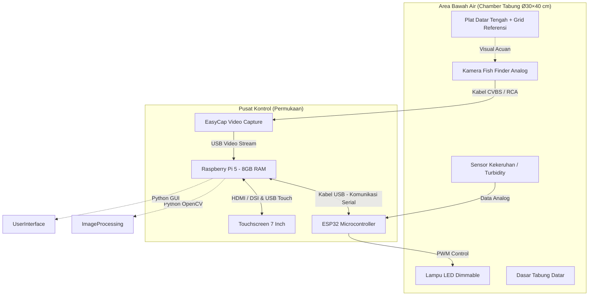

# PRODUCT REQUIREMENTS DOCUMENT (PRD)
**Proyek:** Sistem Pengukuran Panjang Udang Bawah Air
**Versi:** 1.9
**Tanggal:** 4 September 2026
**Platform Utama:** Raspberry Pi 5 (Python GUI)

---

## 1. Ringkasan Eksekutif
Proyek ini mengembangkan sistem *Computer Vision* semi-otomatis untuk mengestimasi ukuran panjang udang secara presisi di bawah air. Sistem menggunakan *chamber* berbentuk tabung (diameter luar 30 cm, panjang 40 cm) dengan dasar datar, plat datar Ø28 cm di tengah tabung sebagai bidang skala (*grid*), dilengkapi dengan pencahayaan adaptif yang menyesuaikan tingkat kekeruhan air. Antarmuka pengguna (GUI) dibangun murni menggunakan Python dan dijalankan secara lokal (Kiosk mode) di Raspberry Pi 5. Pengguna mengoperasikan sistem dengan memantau video *live* dan melakukan *capture* secara manual melalui layar sentuh 7 inch. Jika terdeteksi lebih dari satu udang, sistem memprioritaskan udang terbesar; jika udang terindikasi melayang, pengukuran tetap dilakukan dengan keterangan peringatan.

---

## 2. Arsitektur Sistem (Block Diagram)

Berikut adalah diagram blok interaksi antar perangkat keras. (Gunakan *markdown viewer* yang mendukung Mermaid.js untuk melihat diagram ini, atau Anda bisa membacanya sebagai alur logika).

---

## 3. Kebutuhan Perangkat Keras (Hardware Requirements)

### 3.1. Mekanik & Lingkungan
*   **Chamber:** Berbentuk **tabung** (silinder) dengan **diameter luar 30 cm** dan **panjang 40 cm** — bukan lagi kotak/balok. Dinding tabung bening (akrilik/polikarbonat, ketebalan ~3–5 mm). **Dasar chamber datar** (penutup bawah rata, kedap air). **Tutup atas** dapat dibuka untuk memasukkan udang dan maintenance. Tabung diisi air hingga **~5 cm di atas plat tengah** (level isi ≈ 25 cm dari dasar).
    *   **Plat datar tengah:** Dipasang **horizontal di tengah tabung** (setinggi ~20 cm dari dasar, atau setengah panjang). Diameter plat ≈ **28 cm** (clearance **~0.5–0.7 cm** ke dinding dalam, mengingat diameter dalam tabung ≈ 29–29.4 cm setelah dikurangi dinding 3–5 mm) agar tidak menggesek dinding melengkung. Plat terbuat dari akrilik/polikarbonat atau papan PVC dengan permukaan matte; dipasang pada **bracket/siku** menempel dinding dalam (bukan tiang tengah) agar tidak menghalangi pandangan kamera. Udang diletakkan di atas plat ini, bukan langsung di dasar tabung.
    *   **Ruang bawah plat (~20 cm):** Kosong berisi air; menjadi zona sensor kekeruhan dan sirkulasi. Dasar tabung datar memudahkan pemasangan sensor turbidity.
    *   **Alasan plat tengah:** memisahkan zona pengukuran dari dasar tabung, memudahkan pencahayaan, dan memberi bidang rata untuk *grid* referensi.
    *   **Refraksi dinding silinder:** dinding tabung melengkung berisi air membiaskan pandangan kamera akibat refraksi optik (hukum Snell), **bukan** barrel distortion lensa; posisi kamera diset agar pandangan dominan ke plat datar (lihat §3.3), dan *software* menerapkan koreksi refraksi/perspektif bila diperlukan setelah uji lapangan.
*   **Grid Referensi:** Permukaan **plat datar tengah** memakai pola kotak-kotak **2 × 2 cm** (bukan 1 × 1 cm) pada area **lingkaran diameter ~28 cm**. Kotak di tepi lingkaran akan terpotong parsial — kalibrasi skala mengutamakan area tengah plat yang utuh. Ukuran ini adalah skala kalibrasi kamera/konversi piksel→mm. Pada resolusi EasyCap 640×480, lebar bidang pandang efektif ~30 cm, dan satu kotak 2 cm ≈ **40–45 piksel** di area tengah — cukup terdeteksi di video analog bawah air. Kotak 1 cm terlalu halus (hanya ~20 piksel, mudah pecah karena blur/kekeruhan). Ukuran fisik diukur ulang setelah pemasangan (toleransi cetak/cat).
    *   **Warna permukaan plat:** abu-abu tua matte atau hitam matte (bukan mengkilap). Udang vaname umumnya pucat/transparan; latar gelap membuat tubuh lebih mudah disegmentasi. Cat/laminasi mengkilap ditolak karena pantulan LED.
    *   **Warna garis grid:** putih atau kuning pucat. Garis tipis **2–3 mm**, lurus, kontras tinggi terhadap permukaan plat. Hindari papan catur hitam–putih penuh: pola bolak-balik memecah siluet udang saat pengukuran.
    *   **Bukan:** plat putih + garis hitam (udang pucat hampir hilang di latar), dan bukan permukaan mengkilap.

### 3.2. Pemrosesan & Komputasi
*   **Main Board:** Raspberry Pi 5 (RAM 8GB) dengan MicroSD 32GB Class 10/A1.
*   **Display:** Layar Sentuh (*Touchscreen*) 7 Inch.

### 3.3. Visi & Sensor
*   **Kamera:** Kamera *Fish Finder* dengan sensor/LCD resolusi 800x480. Dipasang di **dinding tabung** pada ketinggian **setinggi plat tengah** (~20 cm dari dasar), menghadap **menunduk ~30–45°** ke permukaan plat *grid*. Orientasi ini meminimalkan pantulan dinding melengkung dan menjaga plat terlihat hampir frontal di tengah *frame*. Kabel CVBS/RCA keluar melalui tutup atas atau gland kedap air di dinding.
    *   **Catatan output CVBS:** Sinyal CVBS (composite video) selalu berformat **4:3** (NTSC: 720×480 @ 29.97 fps atau PAL: 720×576 @ 25 fps), terlepas dari resolusi sensor kamera. Kamera fish finder yang mengklaim 800×480 (16:9) pada panel LCD-nya dapat melakukan *anamorphic squeeze* (mampat horizontal), *letterbox* (bar hitam atas-bawah), atau *crop* (potong sisi) saat mengeluarkan sinyal CVBS. **Perilaku output ini harus diuji di lapangan** sebelum menentukan koreksi aspek rasio yang benar di software.
*   **Video Capture:** EasyCap (CVBS to USB) mentransfer video dengan resolusi akhir 640×480 (4:3). Standar CVBS harus cocok antara kamera dan EasyCap (**NTSC atau PAL**, tidak boleh campur).
*   **Pencahayaan:** Modul LED dipasang **di sisi berlawanan kamera** pada ketinggian plat, menyinari plat secara menyamping agar bayangan udang tidak menutupi siluet. Intensitas dikontrol PWM.
*   **Sub-Controller:** ESP32 (Terhubung ke RPi via Kabel Data USB).
*   **Sensor Ekstra:** Modul Sensor Kekeruhan Air (Turbidity) dipasang di **ruang bawah plat**, dekat dasar tabung, untuk membaca kekeruhan air di zona bawah.
*   **Aktuator:** Modul Lampu LED dengan dukungan *dimming* via tegangan PWM.

### 3.4. Catu Daya (Power Supply)
*   **Raspberry Pi 5:** Adaptor USB-C **5V / 5A** (resmi RPi 5 PSU) atau *power bank* high-output.
*   **ESP32 + Sensor Turbidity:** Ditenagai via USB dari RPi (5V, <500 mA total).
*   **LED Dimmable:** Sumber daya terpisah sesuai spesifikasi modul LED (mis. 12V/2A); ground common dengan ESP32 untuk PWM.
*   **Kamera Fish Finder + EasyCap:** Kamera fish finder biasanya punya PSU sendiri (12V); EasyCap ditenagai USB dari RPi.
*   **Penting:** Semua ground (RPi, ESP32, LED driver, kamera) harus **common ground** untuk menghindari noise pada sinyal analog turbidity dan CVBS.

---

## 4. Kebutuhan Perangkat Lunak (Software Requirements)

### 4.1. Teknologi Utama
*   **Sistem Operasi:** Raspberry Pi OS (Debian based).
*   **Bahasa Pemrograman:** Python 3 (di RPi) dan C++/Arduino (di ESP32).
*   **GUI Framework:** CustomTkinter atau PyQt5/6 (Aplikasi *Desktop Native* yang ringan dan cepat).
*   **Image Processing:** OpenCV (`cv2`) dan NumPy.
*   **Komunikasi Data:** `pyserial` (membaca data dari ESP32 via USB).
*   **Penyimpanan Data:** File CSV untuk *logging* (disimpan di partisi MicroSD 32GB).

### 4.2. Logika ESP32 (Firmware)
*   **Input:** Membaca nilai ADC dari sensor Turbidity secara *looping*.
*   **Komunikasi:** Mengirim *raw turbidity index* (nilai ADC / indeks sensor, **bukan NTU**) ke USB Serial (misal: `TURB: 45`). Mendengarkan perintah PWM dari USB Serial (misal: `PWM: 200`).
*   **Output:** Menerapkan nilai PWM ke pin kontrol lampu LED.

### 4.3. Pipeline Pengolahan Citra (Metode Pengukuran)
Metode **bukan** filter RGB tunggal. Baseline v1 memakai OpenCV dengan ruang warna **HSV + grayscale/luminansi**, karena udang vaname pucat di plat gelap dan pencahayaan/kekeruhan berubah-ubah.

1.  **Pra-proses:** *frame* dari EasyCap → koreksi aspek rasio (sesuai perilaku output CVBS kamera yang diuji di lapangan — lihat §3.3 catatan CVBS; bisa 4:3 asli jika tidak ada squeeze, atau stretch ke 16:9 jika kamera melakukan anamorphic squeeze) → (opsional) koreksi refraksi dari dinding tabung silinder berisi air dan/atau koreksi perspektif plat → *denoise* ringan → **CLAHE** pada kanal kecerahan untuk menambah kontras di air keruh.
2.  **Segmentasi udang (utama):** konversi **BGR → HSV**. Karena tubuh vaname hampir putih/transparan, **Hue tidak diandalkan sebagai ciri utama**. Deteksi mengandalkan kanal **V (Value)** dan/atau grayscale: udang lebih terang dari plat abu-tua/hitam matte → *threshold* (Otsu / adaptif) + morfologi (*open/close*) untuk membersihkan noise.
3.  **Pembersihan siluet:** buang kontur terlalu kecil (noise); dari kontur kandidat tersisa, pilih **udang terbesar** berdasarkan luas siluet. Jika multi dan terpisah → tetap pilih **terbesar** (satu pengukuran per *capture*).
4.  **Panjang tubuh:** skeleton / *medial axis* (atau polylines sepanjang *centerline*) dari kepala ke ekor; jumlahkan panjang sepanjang kurva (bukan garis lurus).
5.  **Skala *grid*:** deteksi garis *grid* (putih/kuning pucat di plat gelap) lewat kontras tinggi — untuk kuning boleh bantu *range* **H** di HSV; untuk putih lebih ke **V** tinggi + saturasi rendah. Hitung mm/piksel dari kotak **2 × 2 cm**; kalibrasi dilakukan di **area tengah plat** (hindari tepi lingkaran yang terpotong atau terdistorsi perspektif). **Kalibrasi skala dilakukan satu kali** saat *first boot* atau saat user menekan tombol "Kalibrasi Grid" (dengan plat kosong tanpa udang), lalu nilai mm/piksel disimpan dan dipakai untuk semua *capture* berikutnya hingga kalibrasi ulang.
6.  **Indikasi melayang (kasar, v1):** heuristik (mis. ukuran siluet vs skala *grid* lokal, ketajaman tepi vs plat, atau area kontak dengan plat) → status `WARN_FLOATING`; bukan pengukuran stereo/depth.
7.  **Yang tidak dipakai sebagai metode utama v1:** filter RGB mentah saja (sensitif cahaya); deteksi hanya berbasis Hue (udang pucat lemah di H); deep learning wajib (boleh ditambah nanti jika dataset lapangan cukup).

---

## 5. Kebutuhan Fungsional (Functional Requirements)

1.  **Pengambilan Gambar Manual:** Sistem tidak memotret otomatis. *Frame* video ditahan (di-*capture*) secara seketika saat tombol "Ukur" ditekan di layar.
2.  **Koreksi Distorsi (Pre-processing):** *Software* Python memperbaiki aspek rasio gambar sesuai perilaku output CVBS kamera (lihat §3.3 — koreksi yang benar tergantung apakah kamera melakukan *squeeze*, *letterbox*, atau *crop*). Jika uji lapangan menunjukkan distorsi refraksi dari dinding tabung silinder berisi air atau sudut kamera menunduk, sistem menerapkan koreksi refraksi dan/atau transformasi perspektif (*homography*) agar *grid* 2 × 2 cm tampak mendekati persegi seragam di area pengukuran.
3.  **Pengukuran Udang (Measurement):**
    *   Pipeline citra mengikuti **§4.3** (HSV + luminansi / V, bukan filter RGB saja).
    *   *Software* mendeteksi kandidat objek udang di *frame*.
    *   **Prioritas multi-udang:** jika terdeteksi **lebih dari satu** udang yang terpisah, sistem **hanya mengukur udang terbesar** (kriteria: luas siluet / panjang kandidat terbesar). Overlay GUI menandai udang yang dipilih. Idealnya operator tetap memasukkan satu udang; prioritas terbesar adalah *fallback*, bukan prosedur utama.
    *   **Saling sentuh / bertumpuk:** jika siluet menyatu ambigu (tidak bisa dipisah andal), *capture* di-*reject* (bukan tebak-tebak mana yang terbesar).
    *   Udang **tidak wajib lurus**. Posisi ideal: menempel datar di plat *grid*. Jika terindikasi **melayang / jauh dari plat**, sistem **tetap mengukur**, tetapi menandai hasil dengan keterangan peringatan (lihat poin 4).
    *   Sistem mengukur panjang mengikuti sumbu tubuh (kurva *centerline* / skeleton dari kepala ke ekor), bukan garis lurus ujung-ke-ujung.
    *   Sistem mengkonversi panjang piksel (sepanjang kurva) menjadi ukuran fisik (mm/cm) menggunakan skala *grid* 2 × 2 cm. Skala ini **paling andal** saat udang di bidang plat *grid*; hasil dengan status melayang bersifat estimasi kasar.
4.  **Validasi, Status Hasil & Notifikasi:** Setelah *CAPTURE*, sistem menilai *frame* dan **wajib** menampilkan notifikasi/indikator di GUI untuk **setiap** hasil — termasuk `WARN_*` dan `REJECT`. Tidak ada kegagalan diam-diam tanpa umpan balik.
    *   **`OK`:** satu udang (atau terbesar terpilih), menempel plat, kontras cukup, tidak blur → panjang resmi. Indikator hijau / netral.
    *   **`WARN_MULTI`:** lebih dari satu udang terpisah; panjang dari **udang terbesar**. Indikator kuning + teks (contoh: `Peringatan: diukur udang terbesar dari 3 kandidat`).
    *   **`WARN_FLOATING`:** udang melayang / jauh dari plat; **tetap diukur**. Indikator kuning + teks (contoh: `Peringatan: udang melayang — akurasi skala menurun`).
    *   **`WARN_MULTI_FLOATING`:** multi-udang (terbesar) + melayang. Indikator kuning + kedua keterangan.
    *   **`REJECT_*` (tidak ada panjang resmi) — tetap ada notifikasi jelas + saran singkat:**
        *   `REJECT_OVERLAP` — siluet saling sentuh/bertumpuk ambigu → *“Udang saling menempel. Pisahkan lalu ukur ulang.”*
        *   `REJECT_BLUR` — *motion blur* / buram → *“Gambar buram. Tunggu udang diam lalu capture lagi.”*
        *   `REJECT_LIGHT` — kontras/pencahayaan buruk → *“Pencahayaan kurang. Sesuaikan lampu (Auto/Manual) lalu ulang.”*
        *   `REJECT_NO_OBJECT` — tidak ada objek → *“Udang tidak terdeteksi. Pastikan ada di frame dan kontras.”*
    *   **Indikator visual wajib:** badge/status berwarna di panel hasil + pesan teks yang terbaca di layar 7"; untuk `REJECT_*` boleh banner singkat di atas/bawah video. Overlay *snapshot* (jika ada) ikut menandai masalah bila relevan.
5.  **Kontrol Lampu Adaptif:**
    *   **Mode Otomatis:** GUI menghitung persentase lampu berdasarkan *raw turbidity index*. Semakin keruh, RPi memerintahkan ESP32 menaikkan intensitas PWM LED. Mode Auto **mengurangi** risiko gagal deteksi, tetapi **tidak menjamin** akurasi pengukuran.
    *   **Mode Manual:** Pengguna dapat menimpa (*override*) kecerahan lampu melalui *slider* pada layar sentuh.
6.  **Penyimpanan Data (Data Logging):** Setiap *capture* yang menghasilkan panjang (`OK` atau `WARN_*`) menulis satu baris CSV plus *file* foto. Kolom CSV minimal: *timestamp*, estimasi panjang, status, catatan/pesan notifikasi, jumlah kandidat udang, persentase kecerahan lampu, *raw turbidity index*, nama *file* foto. Setiap `REJECT_*` **juga** di-log (satu baris) dengan status reject + alasan/pesan, tanpa angka panjang sebagai hasil resmi. **Penyimpanan otomatis:** data dan foto langsung tersimpan setelah setiap CAPTURE (tidak perlu konfirmasi user). Hasil *capture* berikutnya ditambahkan sebagai baris baru (tidak menimpa yang sebelumnya).

---

## 6. Batasan Operasional & Sumber Error (Constraints)

Hal berikut bersifat **syarat pakai** dan risiko yang harus dipahami operator:

1.  **Lebih dari satu udang.** Sistem memilih udang terbesar yang terpisah dan memberi notifikasi `WARN_MULTI`. Udang lain diabaikan. Jika saling sentuh/bertumpuk → `REJECT_OVERLAP` + notifikasi saran. Prosedur terbaik: satu udang per *capture*.
2.  **Udang melayang / jauh dari plat.** Pengukuran **tetap dijalankan** dengan `WARN_FLOATING` + indikator. Error skala bisa signifikan; angka panjang **bukan** setara `OK` di plat. Ulangi saat menempel plat bila butuh hasil resmi.
3.  **Pencahayaan & kekeruhan.** Cahaya kurang, silau, atau air sangat keruh → sering `REJECT_LIGHT` dengan notifikasi minta sesuaikan lampu.
4.  **Gerakan saat *capture*.** Udang bergerak → `REJECT_BLUR` + notifikasi tunggu diam.
5.  **Kalibrasi *grid* di air.** Skala 2 × 2 cm diasumsikan setelah kalibrasi kamera/*chamber* terisi air; posisi kamera bergeser, sudut kamera berubah, atau *grid* aus → perlu kalibrasi ulang.
6.  **Plat lingkaran & perspektif.** Kotak *grid* di tepi plat bulat terpotong dan terdistorsi perspektif di pinggir *frame*; pengukuran panjang paling andal di area tengah plat. Pantulan dari dinding tabung bening dapat menambah noise di tepi citra.
7.  **Ambigu anatomi.** Antena, kaki, atau ekor terbuka/tertutup dapat menggeser titik ujung kepala–ekor; operator memastikan tubuh terlihat utuh di *frame*.
8.  **Di luar cakupan v1:** mengukur *semua* udang sekaligus ke banyak baris CSV, konversi turbidity ke NTU, dan target error numerik (±mm) — ditetapkan terpisah bila ada uji lapangan.

---

## 7. Antarmuka Pengguna (GUI Layout)

Sistem menggunakan desain *Single-Page Dashboard* **orientasi landscape** layar penuh agar mudah ditekan:
*   **Area Tengah (Dominan):** Panel *Live Video Feed* secara *real-time*. Setelah *capture*: *snapshot* + overlay (kurva tubuh / penanda masalah) **plus** banner/badge status yang selalu terlihat.
*   **Area Bawah (Action Bar):** Tombol **"CAPTURE / UKUR"** yang besar dan mudah dijangkau jari.
*   **Sisi Kanan (Informasi & Kontrol):**
    *   **Hasil Ukur + Indikator Status** (wajib selalu terisi setelah *capture*):
        *   hijau `OK` + angka panjang (contoh: `120.5 mm`)
        *   kuning `WARN_MULTI` / `WARN_FLOATING` / `WARN_MULTI_FLOATING` + angka + teks peringatan
        *   merah `REJECT_OVERLAP` / `REJECT_BLUR` / `REJECT_LIGHT` / `REJECT_NO_OBJECT` + pesan saran (tanpa angka panjang resmi)
    *   **Status Kekeruhan:** *Raw turbidity index* (contoh: `TURB 45`), bukan satuan NTU.
    *   **Kontrol Lampu:** 
        *   *Toggle Switch* (Auto / Manual).
        *   *Slider* (0% - 100%) untuk menyesuaikan daya lampu.

---

## 8. Alur Kerja Operasional (User Flow)
1.  **Booting:** Alat dinyalakan. Raspberry Pi memuat OS dan otomatis menjalankan script Python GUI layar penuh (Kiosk, orientasi landscape).
2.  **Kalibrasi Cahaya:** User mengecek *live feed*. Jika air keruh, user menyalakan mode `Auto` atau menggeser *slider* manual hingga plat *grid* dan tubuh udang terlihat kontras.
3.  **Posisi Udang:** Sampel dimasukkan ke *chamber* tabung. Ideal: **satu** udang, menempel datar di plat *grid* tengah, relatif diam. Jika ada beberapa udang, sistem nanti memilih yang terbesar (+ notif). Jika masih melayang, tetap bisa diukur (+ notif peringatan).
4.  **Eksekusi:** User menekan "CAPTURE". Program mendeteksi kandidat, memilih udang terbesar bila multi, menilai posisi/blur/kontras, lalu menampilkan hasil **beserta indikator/notifikasi**. Hasil langsung tersimpan ke CSV + foto (otomatis, tanpa konfirmasi).
5.  **Hasil:**
    *   **`OK` / `WARN_*`:** panjang + indikator/teks; data + foto **otomatis tersimpan** ke CSV.
    *   **`REJECT_*`:** indikator merah + pesan alasan & saran; **otomatis di-log** sebagai reject; user koreksi lalu ulangi dari langkah 3.
6.  **Siap ulang:** Sistem kembali ke mode *live feed* untuk pengukuran berikutnya. Tidak ada batasan jumlah *capture*; setiap hasil ditambahkan sebagai baris baru di CSV.

